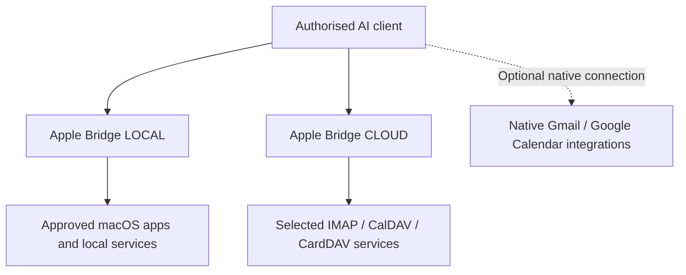

# 🍎 Apple Bridge v2

### Your Apple services. Two independent bridges. One clear purpose.

**A privately operated Model Context Protocol (MCP) integration by MK Universal Solutions Ltd**

**[Overview](#overview) · [Capabilities](#capabilities) · [Architecture](#architecture-local-vs-cloud) · [Privacy](#privacy-and-technical-boundaries) · [Verified status](#verified-operational-status) · [About](#about-this-project)**

---

> [!IMPORTANT]
> **This is a public project showcase, not the production source repository, a hosted service, or a downloadable release.** The two implementations and their operational documentation are maintained in separate source repositories intended for private use. This page contains no production code, account identifiers, credentials, private connection details, or recovery materials.

## Overview

Apple Bridge v2 connects an authorised AI client with supported Apple services. It uses MCP to make tasks such as searching messages, checking calendars, managing reminders, finding contacts and reading selected local information available through an interface with explicit operational boundaries.

The project has **two distinct production systems**:

- **Apple Bridge LOCAL** runs in an authorised macOS user environment. Its last recorded production registry contained **65 MCP tools**, including native Apple app functions, account/person routing, call history, diagnostics and read-only SKS PersonalHealth data access.
- **Apple Bridge CLOUD** runs independently in a private Linux-based environment. Its **11 MCP tools are read-only** and serve explicitly authorised Mail, Calendar and Contacts sources using IMAP, CalDAV and CardDAV.

They use **separate private connections**. The Cloud bridge does not mirror the LOCAL feature set and cannot automatically take over an interrupted LOCAL request.

### Why two bridges?

Some Apple functionality relies on macOS applications, device permissions or a logged-in user session. The independent Cloud path offers more limited, account-scoped reads without requiring that Mac to be available. This is a continuity option for the authorised operator, not an automatic failover service.

## Capabilities

| Service | Apple Bridge LOCAL | Apple Bridge CLOUD |
| :-- | :-- | :-- |
| **Mail** | Browse, search, read and perform explicitly authorised changes | List folders, search, list and read selected mailboxes |
| **Calendar** | Browse calendars and events; authorised event operations | Read-only CalDAV calendars and events |
| **Contacts** | Search, read and perform supported authorised changes | Read-only CardDAV contacts |
| **Reminders and Notes** | Lists, folders, search and supported edits | Not available |
| **Messages** | Read conversations, send via supported iMessage/SMS routing, and target individual message reactions | Not available |
| **Safari** | Supported tab inspection and management | Not available |
| **Call history** | Available local records, read-only | Not available |
| **Account and person routing** | Live discovery and explicitly confirmed mappings and aliases | Exact account/service allowlist, read-only |
| **SKS PersonalHealth** | Read-only local projections, medication-related views and paginated HealthKit history when available | Not available |
| **Diagnostics** | Host and service readiness checks | Server identity and authorised service inventory |

Specific actions depend on the connected client, software version, operating-system permissions, provider availability and the operator's account configuration. **A registered tool is not proof that every possible account, device or write scenario has passed a separate end-to-end test.**

## Architecture: LOCAL vs CLOUD

**LOCAL and CLOUD are separate, privately operated endpoints.** Neither is a public API. Native Google integrations, when connected in the AI client, are separate from both Apple Bridge servers. Cloud does not store or proxy Google account connections.

### Current tool inventories

| | Last recorded registry | Nature of access |
| :-- | --: | :-- |
| **LOCAL** | **65 tools** | Mix of read operations and explicitly authorised actions |
| **CLOUD** | **11 tools** | Read-only, exact account selection required |

The recorded LOCAL inventory includes SKS tools added after the earlier 53-tool catalogue. HealthKit history availability depends on a separately accepted deployment. Because the interface evolves, this public page intentionally provides the **capability overview rather than a stale, supposedly complete list of tool names**. In the operator's private environment, the current MCP registry remains the definitive tool inventory.

## Privacy and technical boundaries

The project emphasises clear separation of responsibilities:

- **Private source and private runtime:** this public repository contains presentation material only. LOCAL and CLOUD are maintained in distinct source repositories intended for private use, with their own release and test histories.
- **Explicit routing:** where supported, account IDs and service permissions determine the intended source. Similar-looking names or aliases do not constitute proof of identity or entitlement.
- **Controlled writes:** CLOUD is read-only. LOCAL writes, sends and deletions require appropriate authorisation; uncertain message delivery is not blindly retried.
- **Independent infrastructure:** CLOUD is a separate, restricted Linux runtime with its own credentials and connection. It does not expose LOCAL-only Messages, Safari, Notes, Reminders or health records.
- **No personal records published:** account addresses, secret material, private configuration, health samples, operational recovery records and live endpoints are excluded from this showcase.

> Account routing and person aliases are organisational aids, **not multi-user authentication or an independent access-control boundary**. Security also depends on the permissions of the connected AI client and the underlying Apple or provider accounts.

## Verified operational status

| Check | Recorded result |
| :-- | :-- |
| **LOCAL · 17–18 November 2026** | 65 tools registered. Earlier connected-client acceptance and basic diagnostics passed. The Mac-dependent endpoint may intentionally be offline. |
| **CLOUD 2.4.0 · 25 November 2026** | Deployment health and the existing secure client connection were verified. The installed ChatGPT plugin worked without reinstallation. |
| **CLOUD tool and service inventory** | 11 read-only MCP tools. Authorised service counts were 5 Mail / 3 Calendar / 1 Contacts. |
| **CLOUD read checks** | Sample Calendar event reads passed on all three accounts. Calendar discovery preserved all collections and their provider names and added component metadata. Sample Mail and Contacts reads passed. |
| **CLOUD source checks for 2.4.0** | Synthetic MCP tests, Linux image build and dependency advisory audit passed. |

The LOCAL count describes registered tools. Each workflow requires its own validation.
These are dated observations of privately operated systems.

## About this project

| | |
| :-- | :-- |
| **Project** | Apple Bridge v2 |
| **Developer / maintainer** | MK Universal Solutions Ltd |
| **Interface** | Model Context Protocol (MCP) |
| **Model** | Local-first private integration plus an independent, limited read-only Cloud path |
| **Public repository** | Showcase and project information only |
| **Production access** | Private to authorised deployments; not offered through this repository |

The project builds upon the open-source **[MrGo2/icloud-mcp](https://github.com/MrGo2/icloud-mcp)** project by Carlos Lorenzo, licensed under MIT. The MK Universal Solutions Ltd deployment includes substantial private adaptations and separate components. Installing the upstream package **does not** install this private build.

This project is **not an official Apple or OpenAI product** and is not affiliated with, sponsored by or endorsed by those organisations.

---

**Built by MK Universal Solutions Ltd**

Private implementation · Independent LOCAL & CLOUD systems · Public project showcase

