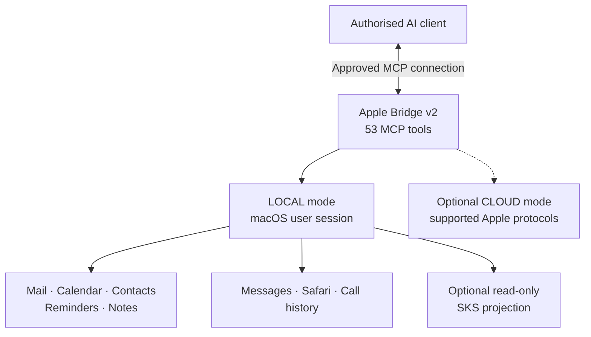

# 🍎 Apple Bridge v2

### Your Apple world. One intelligent bridge.

**A private, local-first Model Context Protocol (MCP) integration for macOS, developed by MK Universal Solutions Ltd.**

  
  
  
  

**[Overview](#overview) · [Capabilities](#what-it-can-do) · [Tool catalogue](#all-53-registered-mcp-tools) · [Architecture](#how-it-works) · [Security](#designed-with-control-in-mind) · [Status](#verified-operational-status)**

---

> [!NOTE]
> **This is the public project showcase, not a source-code distribution.** The production implementation, infrastructure configuration and development history are maintained in a separate private repository. This repository intentionally contains no live credentials, account mappings, private deployment details or personal data.

## Overview

**Apple Bridge v2** connects an authorised AI assistant with supported Apple services available to a macOS user. It brings together communication, organisation, account-aware discovery and selected local information in a single MCP interface.

The project focuses on making Apple services **useful in real workflows**, not simply exposing a collection of commands. Its private deployment is operational and exposes **53 registered MCP tools**, including read-only diagnostics. The 10 November 2026 independent post-restart check confirmed a working ChatGPT connection and **9/9 basic diagnostic checks OK**.

<strong>Why build it?</strong>

Many daily activities are spread across Mail, Calendar, Contacts, Notes, Messages and other applications. Apple Bridge v2 aims to give an authorised AI assistant a consistent, controlled way to work with those services while retaining macOS permissions, explicit account selection and user oversight.

## What it can do

| Area | Capabilities |
|:--|:--|
| 📧 **Mail** | Browse, search, read and manage messages, with explicit account selection for supported operations |
| 📅 **Calendar** | Find calendars and events; create, update and remove events where authorised |
| 👥 **Contacts** | Search and manage contacts, with visibility into supported account containers |
| ✅ **Reminders** | Browse lists, find tasks, create reminders and manage completion |
| 📝 **Notes** | Browse folders, search notes and access supported note operations |
| 💬 **Messages** | Read conversations, send text or supported attachments, select iMessage/SMS routing, safely fall back to SMS for eligible text sends, and target a specific message with a Tapback reaction |
| 🌐 **Safari** | Inspect and manage supported browser tabs |
| 📞 **Call history** | Read-only access to call records available to the local macOS user |
| 🔗 **People & account discovery** | Discover live service accounts, identify ambiguous or stale mappings, and maintain explicitly confirmed person-to-account links and aliases |
| ❤️ **SKS PersonalHealth** | Read-only access to separately received local health projections, including available health status, samples and ECG metadata/data through defined tools |

| 🩺 **Diagnostics** | Read-only checks of MCP registration, host, secure tunnel, local SKS service/projection and Messages bridge readiness |

The availability of individual operations depends on the active mode, configured services, macOS permissions and connected client. **Not every capability is available in CLOUD mode, and 53 registered tools do not mean 53 individually completed functional LIVE tests.**

## Highlights from the latest private build

- **Account-aware workflows:** live discovery across supported Apple services, confirmed person aliases, and explicit account mapping without guessing an owner.
- **Safer message delivery:** `auto`, `imessage` and `sms` routing, with conditional text-only iMessage-to-SMS fallback where the original send is known not to have started. Uncertain sends are not retried blindly.
- **Targeted Tapbacks:** reactions refer to a specific message; bridge readiness is checked separately from real-world reaction delivery.
- **Resilient local operations:** the Messages bridge and SKS health endpoint recovered after a full Mac restart in the recorded acceptance test. The Messages bridge may take several minutes to become ready after login.
- **Privacy-conscious health access:** read-only views of a separately managed local SKS projection; no health records are included in this repository.
- **Built-in diagnostics:** a read-only `diagnostics` tool reports readiness and health-check results without launching Apple applications in basic mode.

## All 53 registered MCP tools

The names below describe the **actual MCP tool interface** present in the private production build. They are published for transparency and discovery, **not as API access to the private server**. Tool execution depends on permissions, mode and the connected client's authorisation.

<strong>Show the full 53-tool catalogue by category</strong>

| Category | Tools | Registered MCP tool names |
|:--|--:|:--|
| Core & connection | 3 | `about`, `check-auth-status`, `set-mode` |
| Mail | 6 | `list-emails`, `read-email`, `send-email`, `search-emails`, `mark-as-read`, `list-folders` |
| Calendar | 5 | `list-events`, `create-event`, `update-event`, `delete-event`, `list-calendars` |
| Contacts | 7 | `list-contacts`, `search-contacts`, `read-contact`, `create-contact`, `delete-contact`, `list-contact-accounts`, `list-contact-groups` |
| Reminders | 7 | `list-reminder-lists`, `list-reminders`, `create-reminder`, `update-reminder`, `complete-reminder`, `delete-reminder`, `search-reminders` |
| Notes | 5 | `list-note-folders`, `list-notes`, `read-note`, `create-note`, `search-notes` |
| Messages | 4 | `list-chats`, `read-messages`, `send-message`, `react-message` |
| Safari | 4 | `list-safari-tabs`, `get-current-safari-url`, `open-safari-url`, `close-safari-tab` |
| People & account mapping | 7 | `set-person-alias`, `discover-person-accounts`, `list-service-accounts`, `list-person-accounts`, `set-person-account`, `remove-person-account`, `search-person-data` |
| Call history | 1 | `search-calls` |
| SKS PersonalHealth | 3 | `get-health-status`, `read-health-samples`, `read-health-ecg` |
| Diagnostics | 1 | `diagnostics` |

## How it works

**Local-first, with clear boundaries.** In its primary configuration, the bridge uses the native macOS environment and permissions. The MCP server itself communicates over standard input/output; any remote connection is handled separately by an authorised, securely configured transport.

Optional cloud integrations use supported protocols for a narrower set of services. Local-only operations depend on the host Mac and cannot be assumed to work in the cloud.

## Designed with control in mind

- **Explicit account ownership:** profiles and aliases are confirmed rather than inferred from similar-looking names.
- **Permission-aware access:** local operations rely on the relevant macOS authorisation mechanisms.
- **Safer mutations:** operations that send messages or change data are treated differently from read-only lookups.
- **Fail-closed behaviour:** unknown account mappings and ambiguous targets should not be silently guessed.
- **Tested change control:** the private development repository uses regression and MCP interface smoke tests.
- **Data minimisation:** this public showcase contains no production configuration, personal records, access tokens or service credentials.

> [!IMPORTANT]
> **Account mappings are routing aids, not user authentication.** A connected AI client can receive information returned by its authorised MCP tools. Security therefore depends on both local permissions and the access policy of the client and connection.

## Verified operational status

The latest independently observed production acceptance was completed on **10 November 2026 (UTC)**, following a full restart of the authorised Mac.

| Check | Recorded result |
|:--|:--|
| Registered tools through ChatGPT | **53/53 available** |
| Read-only basic diagnostics | **9 OK, 0 warnings, 0 errors, 0 unknown** |
| Server connection | ChatGPT Secure MCP Tunnel responded successfully |
| Local SKS integration | Health endpoint and projection checks passed after restart |
| Messages bridge | Automatically became ready after login; the first attempt timed out and a later scheduled check completed successfully |

**Scope of verification:** `about` and `diagnostics(level="basic")` were invoked through the real connected client. This does not establish end-to-end correctness of every tool, that a Tapback reaction was delivered, or ongoing receipt of new health samples. The optional CLOUD mode was not part of this acceptance.

## Project snapshot

| | |
|:--|:--|
| **Project** | Apple Bridge v2 |
| **Organisation** | MK Universal Solutions Ltd |
| **Deployment** | Private, operational macOS installation; latest post-restart acceptance 10 November 2026 |
| **Interface** | Model Context Protocol (MCP) |
| **Current tool catalogue** | 53 registered MCP tools (names listed above) |
| **Primary approach** | Local-first, account-aware, permission-conscious |
| **Public availability** | README-only project showcase; no production source, credentials or configuration published |

The public page is a showcase of an independently maintained integration. It is **not a hosted service, a downloadable release or an invitation to connect to the production installation**.

## Foundations and acknowledgements

Apple Bridge v2 builds upon the work of **Carlos Lorenzo**, creator of the upstream [MrGo2/icloud-mcp](https://github.com/MrGo2/icloud-mcp) project. The upstream project is published under the MIT licence. MK Universal Solutions Ltd has developed and integrated additional functionality for its own deployment.

The upstream package and this private customised installation are **not interchangeable**. Installing `mcp-icloud` from npm does not install the private MKUS extensions. The tool names on this page are an overview, not a downloadable package.

This project is **not affiliated with, endorsed by or an official product of Apple or OpenAI**. Apple, iCloud, iMessage, macOS and other trademarks remain the property of their respective owners.

---

### Built by MK Universal Solutions Ltd

**Practical integration. Clear boundaries. Real-world operation.**

Public showcase · Private production system · © MK Universal Solutions Ltd

